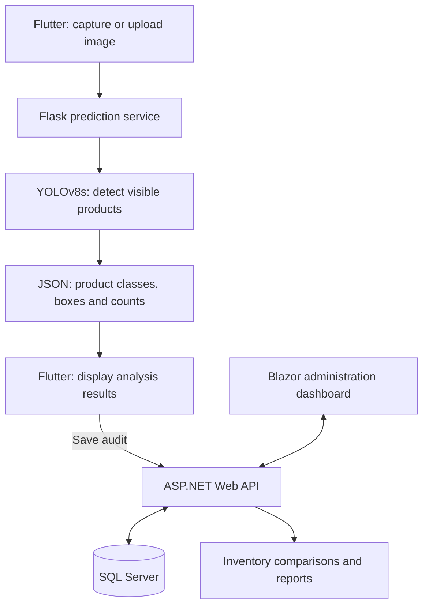
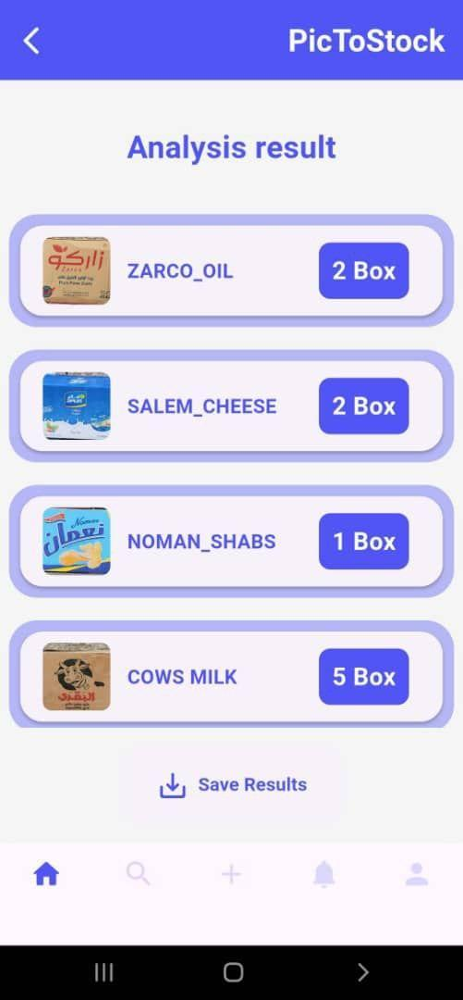
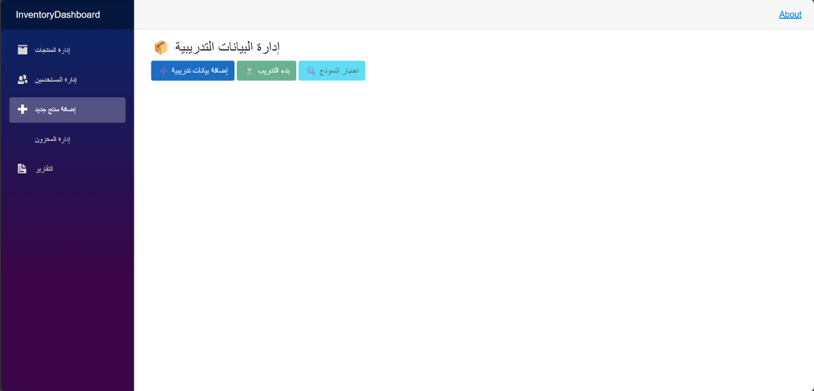
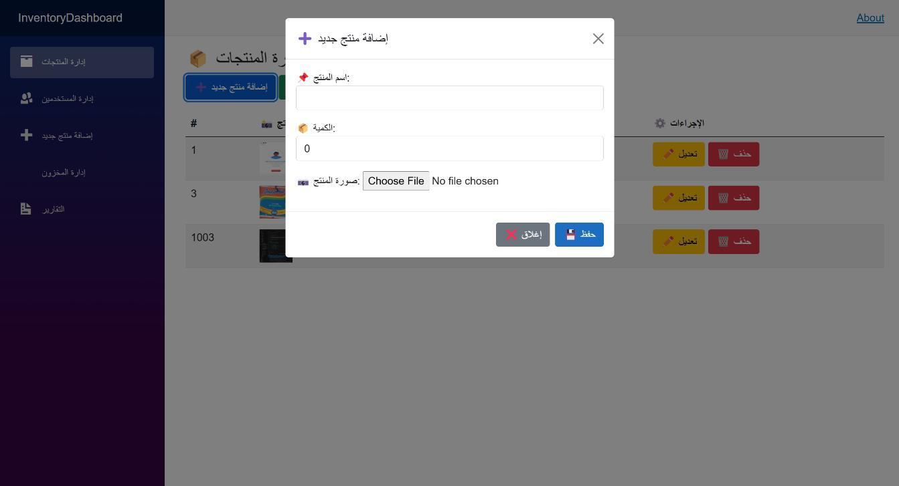

# PicToStock | Smart Inventory System

**A computer vision graduation project connecting product detection with an inventory workflow.**

Flutter · Flask · YOLOv8s · ASP.NET Web API · SQL Server · Blazor

PicToStock explores how smartphone images can assist stocktaking: detect visible products, return estimated counts, and save the results for inventory comparison and reporting.

> **Portfolio case study:** This repository contains documentation and selected screenshots from a five-person graduation project. Application source code, model weights, and datasets are not included. The description is based on the project report and my CV; no application execution or independent testing was performed for this showcase.

## The problem

Manual stocktaking requires repeated counting and data entry. PicToStock investigates a photo-assisted workflow that connects object detection to inventory records, with the aim of reducing that manual effort. Time savings and operational reliability have not been established by a controlled study.

## My contribution

I am **Abdul Salam Al-Saeedi**, one member of the five-person project team. My focus was the data pipeline and AI model:

- Led dataset collection and bounding-box annotation.
- Trained the product detection model.
- Contributed to the administration dashboard.

These responsibilities are stated in my CV. The mobile app, backend, database, and dashboard described below represent the team's overall system; they are not claims of sole authorship.

## Documented workflow and architecture



1. A user captures or uploads a product image in the Flutter app.
2. Flask receives the image at `/predict` and uses YOLOv8 to detect visible products.
3. The service returns detection information as JSON; the app displays product names and counts.
4. Saving sends the audit to the ASP.NET Web API, which checks product records and stores audit data in SQL Server.
5. The app and Blazor dashboard provide access to inventory information and reports. The dashboard also documents product and training-data management interfaces.

This is a summary of the report's workflow, not a verified API contract. See [evidence and source notes](docs/evidence.md).

| Component | Technology | Documented responsibility |
| --- | --- | --- |
| Mobile client | Flutter / Dart | Image capture, upload, results and reports |
| Inference service | Python / Flask | Image prediction endpoint and JSON responses |
| Detection model | YOLOv8s | Product localization and classification |
| Inventory backend | ASP.NET Web API / C# | Product checks, audit persistence and comparisons |
| Storage | SQL Server | Products, inventory and reporting data |
| Administration | Blazor | Product, inventory and training-data interfaces |

## Screenshots

Original images extracted from the graduation report. These show the documented interface, not a new live demonstration. Image quality is limited by the embedded source images.

<table>
<tr><th>Mobile home</th><th>Analysis results</th></tr>
<tr>
<td></td>
<td></td>
</tr>
</table>

The result screen uses the label “Box.” This does not mean the model can see or count hidden items inside packaging.

**Training-data administration**



**Adding a product**



The presence of a control in a screenshot does not independently verify its behavior.

## Dataset and training

| Item | Documented value | Source |
| --- | --- | --- |
| Dataset size | Approximately 800 images | CV; not independently verified from dataset files |
| Product categories | 17 | CV; class list not included in this repository |
| Annotation | Bounding boxes using Roboflow | CV; report describes YOLO-format export |
| Train / validation / test split | 80% / 10% / 10% | Report, PDF page 73; also stated in CV |
| Model | YOLOv8s | Report, PDF page 75 |
| Optimizer | AdamW | Report, PDF page 75 |
| Training time | 8 GPU-hours | Report, PDF page 75; hardware not specified there |

## Results and limitations

**Reported model metric: 94.3% mAP@50.** The report lists this under training results on PDF page 75. My CV identifies it as a validation-set result; the report page itself does not identify the evaluation split. mAP@50 is an object detection metric, not a production accuracy or inventory-count accuracy guarantee. Evaluation artifacts are not available in this repository for independent verification.

The same report page describes an informal practical trial as approximately “50%” and says outputs were sometimes correct and sometimes wrong or incomplete. It provides no formal protocol, sample size, or definition of that percentage. It therefore cannot be compared numerically with mAP@50. The observation does indicate a gap between the reported evaluation result and practical reliability.

Other limits matter for deployment:

- **Visible products only:** the system does not infer the contents of closed boxes or count products hidden behind other items (PDF page 78).
- **Limited evidence:** no independent benchmark, reproducible training run, or verified deployment is supplied here.
- **Result correction is unresolved in the documentation:** the results-screen description discusses review and possible correction, while the implementation workflow says manual editing of boxes and quantities is not allowed. Manual correction is not presented here as an established feature.
- **Dataset coverage needs further work:** the documented practical failures motivate more representative images and error analysis before operational use.

## Next steps

These are proposed improvements, not implemented features:

- Evaluate on a fixed, independently collected set of warehouse scenes; document sample counts, per-class metrics, and counting errors.
- Audit train/validation/test separation and dataset balance, then expand examples for difficult viewpoints, lighting and partial occlusion.
- Add a human review and correction step before inventory updates, with an audit trail.
- Record model versions, inference failures and confidence thresholds; test the complete image-to-audit workflow.
- Package setup instructions, configuration examples and tests when the team's source code is available for release.

Continuous camera-based stocktaking, ERP integration and predictive inventory analysis appear as future directions in the report. They are outside the demonstrated scope of this case study. Hidden contents would require additional evidence such as scans or packaging records; images alone do not reveal them.

## Repository contents

```text
README.md
assets/
  screenshots/
    mobile-home.jpg
    analysis-results.jpg
    training-data.png
    add-product.jpg
docs/
  evidence.md
```

There are no installation or run commands because this is a documentation-only showcase. The full academic report and CV are intentionally excluded. Source attribution and review qualifications are recorded in [docs/evidence.md](docs/evidence.md).
